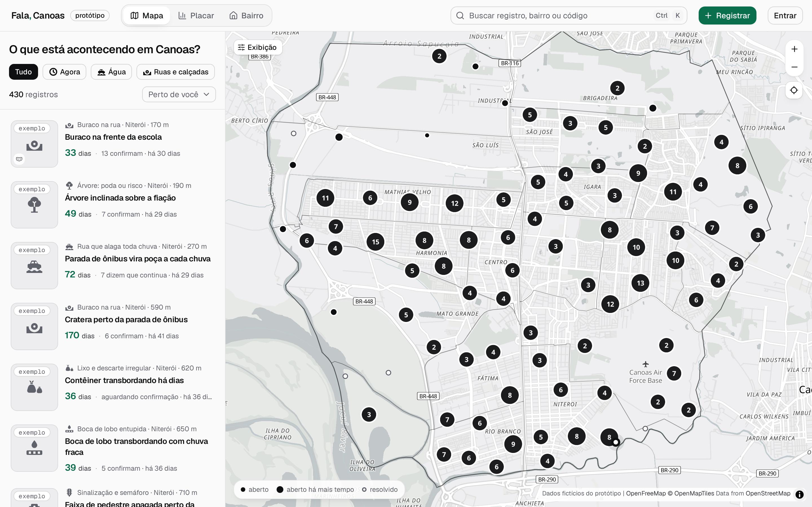

<p align="center">
  
</p>

<h1 align="center">Fala, Canoas</h1>

<p align="center">
  Mapa independente e de código aberto para acompanhar, em dias, os problemas urbanos de Canoas, RS.
</p>

<p align="center">
  
  <br />
  <sub>O mapa, com os registros de exemplo (dados fictícios).</sub>
</p>

Quem mora na cidade registra um problema com foto: buraco, lixo, poste apagado, bueiro entupido, rua que alaga. Uma vez por dia os registros novos vão à Ouvidoria da Prefeitura, e a partir do envio um relógio público conta os dias. O registro só fecha quando os vizinhos confirmam o conserto. Um placar mostra onde os problemas se acumulam e quanto tempo cada órgão leva.

O Fala, Canoas **não é um canal da Prefeitura**. É um projeto independente, sem dinheiro de governos, partidos ou candidatos.

> **Estado atual: protótipo.** O código está completo o bastante para rodar de ponta a ponta em desenvolvimento, mas o serviço ainda não foi aberto ao público. Os registros marcados como "exemplo" são dados fictícios.

Este repositório reúne o **Fala Core** (o domínio, reutilizável por outras cidades) e a sua primeira instância, **Fala, Canoas**.

## Como funciona

1. Uma pessoa registra um problema no mapa, com foto e lugar. Fotos passam por moderação antes de aparecer.
2. Às 18h, os registros novos seguem num resumo para a Ouvidoria, em nome do Fala, sem identificar quem registrou.
3. O relógio público começa no envio.
4. Vizinhos confirmam que o problema existe, avisam se continua e dizem quando foi resolvido.
5. O placar soma tudo por bairro, por tipo de problema e por órgão. Ele nomeia órgãos, nunca pessoas.

As decisões de produto, com as alternativas descartadas, estão em [`research/DECISIONS.md`](research/DECISIONS.md). O resumo do produto está em [`PRODUCT.md`](PRODUCT.md) e o sistema visual em [`DESIGN.md`](DESIGN.md) (os três em inglês).

## Privacidade, em resumo

- O número de celular nunca chega ao aplicativo: fica cifrado num serviço separado (o cofre de identidade), com banco e segredos próprios.
- Em público aparecem só o apelido e o bairro, ou "Anônimo".
- Fotos têm os metadados removidos (EXIF, GPS) antes de serem guardadas.
- A triagem automática de fotos roda em servidor no Brasil; para a checagem de material de abuso conhecido saem apenas impressões digitais das imagens, nunca as fotos.
- Os dados abertos trazem os registros publicados com o ponto aproximado, sem autores e sem as palavras de quem mora na cidade.

## Rodar localmente

Você precisa de:

- [Bun](https://bun.sh) 1.4 ou mais novo;
- um projeto [Supabase](https://supabase.com) (Postgres e Storage). O projeto usa a região de São Paulo, mas qualquer uma serve para desenvolver.

```sh
bun install
cp apps/web/.dev.vars.example apps/web/.dev.vars
cp apps/vault/.dev.vars.example apps/vault/.dev.vars
```

Preencha em `apps/web/.dev.vars`:

- `BETTER_AUTH_SECRET` (gere com `openssl rand -base64 32`);
- `DATABASE_URL` (a string do pooler de sessão do Supabase, com o papel `postgres`);
- `SUPABASE_URL` e `SUPABASE_SECRET_KEY`.

Depois, na raiz do repositório:

```sh
bun run vault:keys    # chaves do cofre de identidade
bun run push:keys     # par de chaves das notificações
bun run db:migrate    # cria os esquemas do app e do cofre
bun run db:roles      # dá a cada serviço o seu papel no banco
bun run db:seed       # carrega os registros de exemplo
bun run dev           # http://localhost:3100
```

Em desenvolvimento, os códigos de entrada não são enviados por WhatsApp ou SMS: a própria página mostra o código.

Os outros serviços são opcionais e sobem separados. Cada um tem um `.env.example` com as variáveis que lê:

```sh
bun --filter @fala/dados dev       # API de dados abertos, :3400
bun --filter @fala/digest agora    # um resumo diário agora (o e-mail cai em apps/digest/outbox/)
bun --filter @fala/whatsapp dev    # o número de WhatsApp do projeto, :3300
bun --filter @fala/triagem models && bun --filter @fala/triagem dev   # triagem de fotos, :3500
```

A lista completa de comandos está em [`CLAUDE.md`](CLAUDE.md) (em inglês), que também serve de guia para quem contribui com a ajuda de agentes de IA.

## Verificações

```sh
bun run typecheck
bun run lint
bun test
bun run format
```

## Estrutura

| Pasta               | O que é                                                                                               |
| ------------------- | ----------------------------------------------------------------------------------------------------- |
| `packages/core`     | O domínio: esquemas, o modelo de um registro, as regras de confirmação, moderação e prazos. Sem E/S.  |
| `packages/dev-vars` | Configuração de desenvolvimento para o que roda fora dos Workers.                                     |
| `instances/canoas`  | A instância de Canoas como configuração: categorias, órgãos, bairros, mapa, marca e dados de exemplo. |
| `apps/web`          | O aplicativo (TanStack Start em Cloudflare Workers): página inicial, mapa, placar, bairros, Você.     |
| `apps/vault`        | O cofre de identidade: guarda o celular cifrado, envia e confere códigos, assina quem entrou.         |
| `apps/cards`        | Desenha os cartões de compartilhamento (imagens 1200×630).                                            |
| `apps/digest`       | O resumo diário à Ouvidoria (e-mail com PDF), o relatório mensal e o arquivo dos pluviômetros.        |
| `apps/whatsapp`     | O número de WhatsApp do projeto: confirma inscrições e recebe registros.                              |
| `apps/dados`        | A API de dados abertos (JSON, GeoJSON e CSV).                                                         |
| `apps/triagem`      | Triagem automática de fotos (nudez, rostos, placas, material de abuso conhecido).                     |
| `research/`         | A pesquisa que sustenta as decisões: Canoas, aspectos legais, identidade, mapas, alagamentos.         |

O código e os comentários são em inglês; tudo o que a pessoa lê na tela é em português do Brasil.

## Levar para outra cidade

O Fala Core não sabe nada de Canoas: a cidade inteira é um arquivo de configuração em `instances/canoas` (bairros e seus polígonos, categorias, órgãos responsáveis, prazos, marca). Uma nova instância é uma nova pasta em `instances/`, validada pelos mesmos esquemas. A licença pede que as melhorias voltem a ser públicas (veja abaixo).

## Como contribuir

Leia [`CONTRIBUTING.md`](CONTRIBUTING.md). Em resumo: abra uma issue antes de mudanças grandes, siga as regras do projeto (várias são conferidas pelo lint) e inclua testes para a lógica de domínio.

Toda participação segue o [Código de Conduta](CODE_OF_CONDUCT.md).

## Segurança

Encontrou uma falha de segurança ou de privacidade? **Não abra uma issue pública.** Veja [`SECURITY.md`](SECURITY.md).

## Licença e créditos

- **Código:** [AGPL-3.0](LICENSE). Quem rodar uma versão modificada como serviço na rede precisa oferecer o código-fonte dessa versão a quem a usa.
- **Geometria dos bairros e do município:** IBGE, Censo 2022 e Malha Municipal (fontes em `research/maps/data/`).
- **Mapa base:** [OpenFreeMap](https://openfreemap.org), com dados © colaboradores do [OpenStreetMap](https://www.openstreetmap.org/copyright).
- **Chuva:** rede de pluviômetros do Cemaden.
- **Fontes:** Geist e Geist Mono, SIL Open Font License (o texto acompanha os arquivos das fontes).
- **Triagem de fotos:** modelos abertos baixados na instalação (NudeNet, um detector de rostos Ultra-Light e um detector de placas YOLOv9) e o algoritmo PDQ, da Meta; as imagens de teste do PDQ têm a origem descrita em `apps/triagem/test/pdq/SOURCE.md`.
